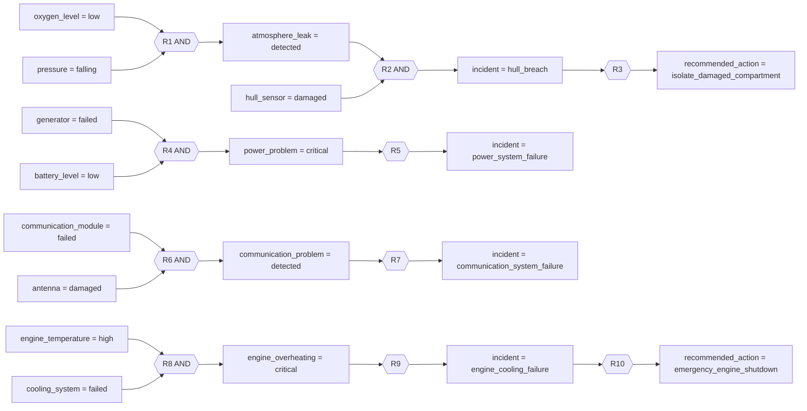

# Експертна система діагностики аварій космічного корабля

## Лабораторна робота

Лабораторна робота №2: **зворотне логічне виведення** (Backward Chaining).

## Мета роботи

Реалізувати продукційну експертну систему, яка починає пошук від обраної
гіпотези, рекурсивно доводить проміжні висновки, звертається до користувача
тільки за потрібними базовими фактами та наочно демонструє LIFO-стек.

## Предметна область

Система діагностує розгерметизацію корпусу, відмову енергосистеми,
несправність зв'язку та відмову охолодження двигуна космічного корабля. Це
навчальна модель продукційних залежностей, а не модель реального апарата.

## Зв'язок із попередньою лабораторною

- **Lab1:** Forward Chaining + FIFO.
- **Lab2:** Backward Chaining + LIFO Stack.

З `C:\codes\IS\lab1` концептуально повторно використано моделі `Condition`,
`Conclusion`, `Rule`, `Fact`, `ValueSource`, `VariableMetadata`, структуру
`WorkingMemory`, усі назви та допустимі значення змінних і правила R1–R10.
Lab1 не змінювалася. Структурної адаптації бази знань не знадобилося.

## Дерево рішень

Діаграма точно відображає фактичні продукційні правила. Вузол `AND` означає,
що для спрацювання правила мають бути доведені всі вхідні умови.



## База знань

| Правило | ЯКЩО | ТО |
|---|---|---|
| R1 | `oxygen_level = low` AND `pressure = falling` | `atmosphere_leak = detected` |
| R2 | `atmosphere_leak = detected` AND `hull_sensor = damaged` | `incident = hull_breach` |
| R3 | `incident = hull_breach` | `recommended_action = isolate_damaged_compartment` |
| R4 | `generator = failed` AND `battery_level = low` | `power_problem = critical` |
| R5 | `power_problem = critical` | `incident = power_system_failure` |
| R6 | `communication_module = failed` AND `antenna = damaged` | `communication_problem = detected` |
| R7 | `communication_problem = detected` | `incident = communication_system_failure` |
| R8 | `engine_temperature = high` AND `cooling_system = failed` | `engine_overheating = critical` |
| R9 | `engine_overheating = critical` | `incident = engine_cooling_failure` |
| R10 | `incident = engine_cooling_failure` | `recommended_action = emergency_engine_shutdown` |

Базові змінні визначаються алгоритмічно: це змінні, які не є висновком
жодного правила. `navigation_system` збережена з Lab1 у доменній моделі, але
не запитується, бо не входить до шляху жодної з наявних цілей.

## Структури даних

- **Knowledge Base** — незмінна послідовність об'єктів `Rule` у
  `knowledge_base.py`.
- **Condition Variable List** — упорядкований `condition_variables`, що
  автоматично будується з умов правил.
- **Conclusion Variables List** — упорядкований `conclusion_variables` та
  точний індекс `rules_by_conclusion[(variable, value)]`.
- **Working Memory** — окремий об'єкт на кожен запуск; кожна змінна має ім'я,
  `initialized`, значення та джерело `USER`, `RULE` або `SCENARIO`.
- **Logical Inference Stack** — клас `InferenceStack` з операціями `push`,
  `pop`, `peek`, `is_empty`; історія кожної операції містить snapshot стеку.
- **Condition Pointer / Protocol** — `ProtocolEntry` з поточною ціллю,
  правилом, номером умови, expected/actual значенням, результатом, джерелом і
  станом стеку.

Рекурсивна процедура `prove()` керує вкладеним виконанням proof, а явний
`InferenceStack` матеріалізує поточний шлях із target та вивідних subgoals,
візуалізує його і перевіряє дотримання LIFO під час `POP`.

## Алгоритм зворотного виведення

1. Користувач обирає точну ціль `Goal(variable, value)`.
2. Створюються чисті робоча пам'ять, протокол і LIFO-стек; ціль виконує `PUSH`.
3. Рушій шукає правила за точним ключем `(variable, value)`.
4. Для кожної умови вже відомий факт порівнюється з очікуваним значенням.
5. Якщо змінна умови є висновком правила, вона стає підціллю, виконує `PUSH`
   і доводиться тим самим механізмом.
6. Якщо змінна не є висновком жодного правила, її значення запитується через
   незалежний `FactProvider`; `input()` у рушії відсутній.
7. За істинності всіх умов правило спрацьовує, а його висновок записується в
   пам'ять із джерелом `RULE`. Підціль виконує `POP`.
8. Якщо правило не підходить, перевіряється наступне правило для тієї самої
   цілі. Поточний proof path захищений множиною від циклів.
9. Результат містить статус, факти, правила у фактичному порядку спрацювання,
   логічний ланцюг, історію стеку та повний протокол.

Фінальний логічний ланцюг містить лише успішну гілку доказу. Перевірки та
факти відхилених candidate rules залишаються в повному протоколі, але не
потрапляють до final proof chain. Для запитуваного базового факту користувач
може відповісти `Невідомо`; у такому разі факт не створюється.

Стисло: `TARGET → RULE → SUBGOALS → BASE FACTS → PROOF`.

## Приклад

Для цілі `recommended_action = isolate_damaged_compartment` пошук іде назад:

```text
recommended_action = isolate_damaged_compartment
↑ R3
incident = hull_breach
↑ R2
atmosphere_leak = detected + hull_sensor = damaged
↑ R1
oxygen_level = low + pressure = falling
```

Після отримання базових фактів фактичний порядок спрацювання правил є
протилежним до напрямку пошуку цілі:

```text
R1 -> R2 -> R3
```

## Структура проєкту

```text
lab2/
├── main.py
├── models.py
├── variables.py
├── knowledge_base.py
├── working_memory.py
├── backward_engine.py
├── goals.py
├── ui.py
├── README.md
└── tests/
    ├── __init__.py
    └── test_backward_engine.py
```

## Запуск

Потрібен Python 3.10 або новіший. Використовується тільки Standard Library.

```bash
python main.py
```

## Тести

```bash
python -m unittest discover -s tests -v
```

Тести не використовують консольний ввід: контрольовані відповіді передаються
через fake `FactProvider`.

## Межі реалізації

У Lab2 реалізовано тільки **backward chaining** із LIFO-стеком. Forward
chaining та hybrid chaining навмисно не реалізовані.
